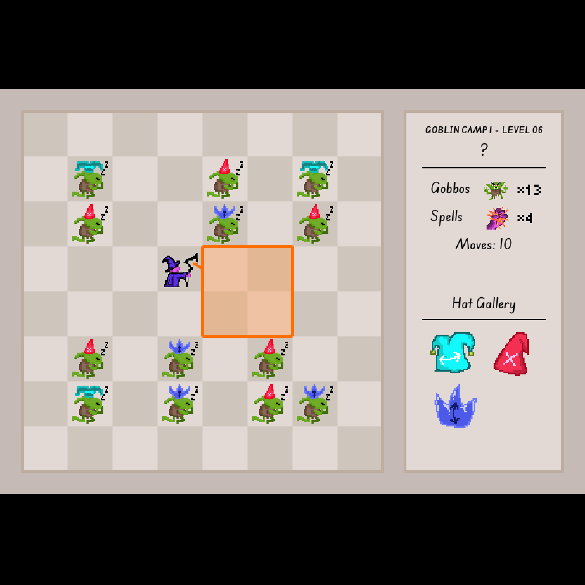

# Gobbo Slayor

This game started from a bare concept by my brother Terri. We've been playing around with sokoban mechanics, but few of them were very interesting.

This seemed like a PuzzleScript compatible game, but since it was also kinda complex, I could tell that working in PuzzleScript would require wrestling with the syntax.

# Stinky Engine

I wanted to collaborate with my siblings, who are voluntarily non-technical people, so I came up with the idea of just vanilla HTML and JS, with levels formatted as text strings (like Baba Is You levels). Then they could experiment with levels locally, and updating the game would only require pushing to git.

That was the main motivator in going engine-less, but I didn't regret it at all and came across many benefits along the way:

- For such a simple game with few moving parts, skipping engine boilerplate meant I iterated really really fast
- Vanilla JS and HTML made for really easy deployment with Github Pages
- Inherently cross platform
- If I didn't feel like building UI (I ended up building UI) I could use HTML elements
- Running it on your browser felt like making a flash game
- I'm a highly visual creator and seeing immediate updates got me flowing really well
- The chrome JS debugger is really quite good
- A twisted sense of satisfaction in Rolling Your Own "engine"

a